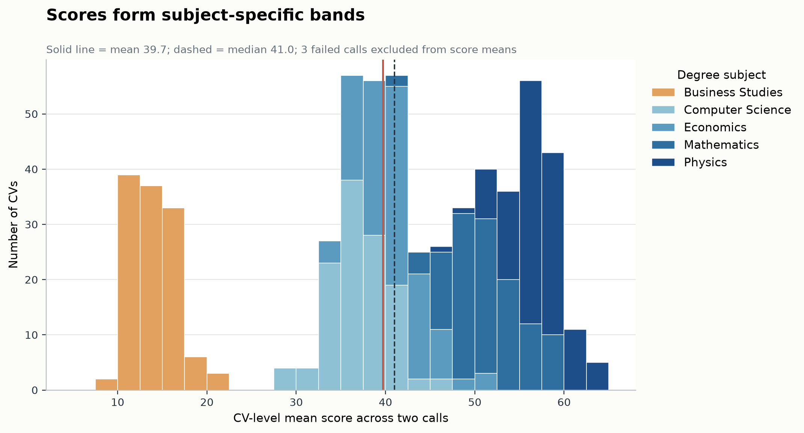
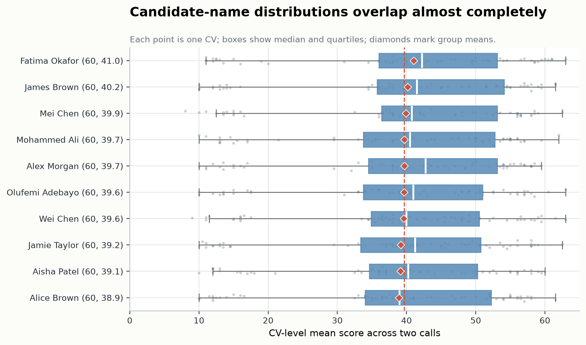
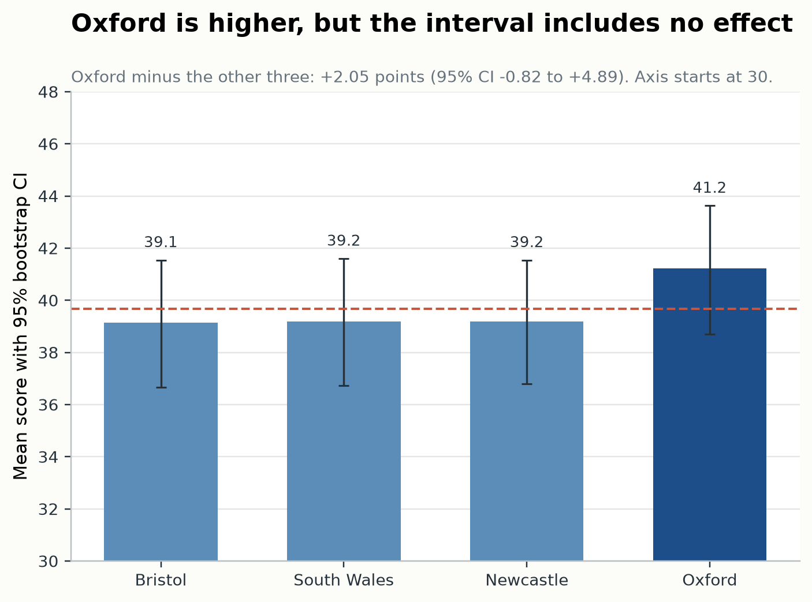
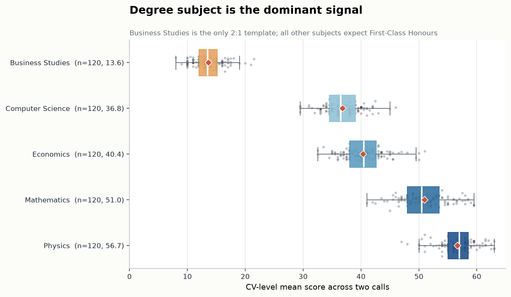
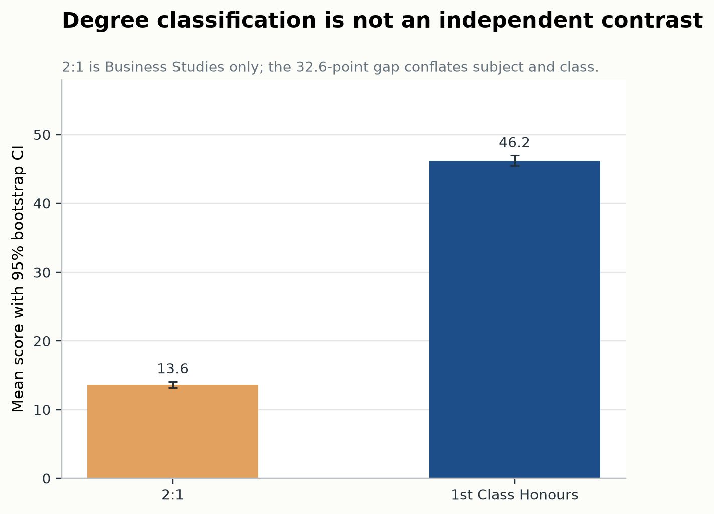
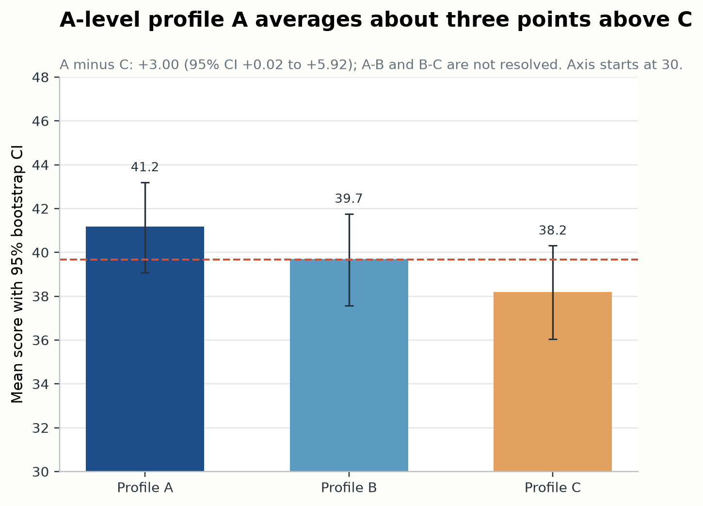
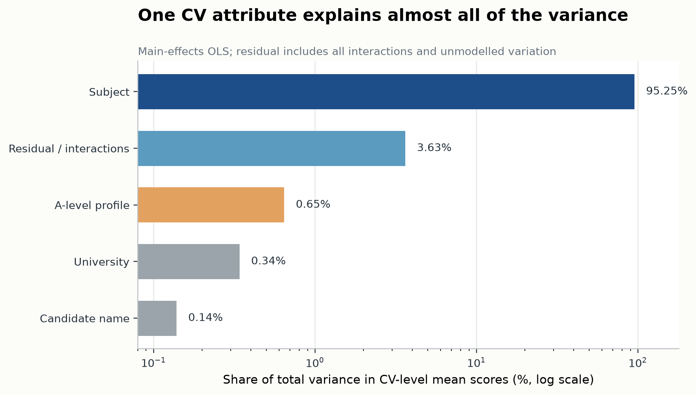
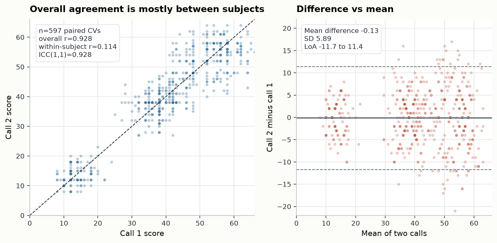
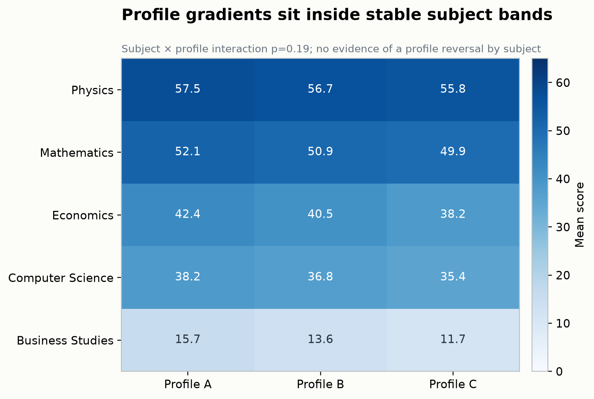

# CV-screening-600: attribute sensitivity in model-scored CVs

**Question:** How much do candidate name, university, degree subject, degree classification, and A-level profile move a hosted model's CV scores?

**Short answer:** Degree-subject template dominates. The other attributes move scores by only a few points, and repeated calls on the same CV are close to uncorrelated once subject bands are removed.

## Design and data

- **600 synthetic CVs**, fully crossed: 10 candidate names × 4 universities × 5 degree subjects × 3 A-level profiles.
- **Degree classification is nested:** all 120 Business Studies CVs expect a 2:1; the other 480 CVs expect First-Class Honours.
- **Two independent calls per CV** at temperature 0, using a hosted MiniMax M3.1 Flash Free model. Provider and endpoint details are omitted.
- **1,200 attempted calls:** 1,197 served responses, all 1,197 parse-valid; 3 provider HTTP 429s excluded. No scores were imputed.
- **Primary unit:** the CV-level mean across available calls. Three CVs have one call.
- **Score rule:** parse the single `XX/100` line requested by the prompt; scores above 100 are invalid.

This is a descriptive factorial study of one model and one job description, not a benchmark or a hiring recommendation.

## Headline findings

- **Overall:** mean **39.7**, median **41.0**, SD **15.2**, range **8–63**. Scores form distinct subject bands rather than one smooth distribution.
- **Degree subject dominates:** Physics **56.7**, Mathematics **51.0**, Economics **40.4**, Computer Science **36.8**, Business Studies **13.6**. Subject explains **95.2%** of CV-level variance.
- **Classification is confounded:** Business Studies is the only 2:1 template. The 32.6-point “classification gap” cannot be separated from subject and CV content.
- **University is weak:** Oxford averages **41.2** versus **39.1–39.2** elsewhere. Oxford minus the other three is **+2.05** (95% CI **−0.82 to +4.89**).
- **A-level profile is small but ordered:** A **41.2**, B **39.7**, C **38.2**. A minus C is **+3.00** (95% CI **+0.02 to +5.92**).
- **Candidate name is negligible:** **38.9–41.0**, a **2.09-point** range whose interval includes zero. Name explains **0.14%** of variance.
- **Apparent reliability is mostly between-subject:** overall Pearson **r=0.928** and ICC **0.928**, but after centering within subject the correlation is **r=0.114**. Per-subject correlations range from **−0.08 to 0.32**.
- **Scores collapse onto a few integer buckets:** **128/1,197** calls scored exactly **38**, **82** exactly **12**, and **71** exactly **58**. About a third of Business Studies and Computer Science calls land on a single modal value.

*Figure 1. The overall distribution is not a single bell curve: each degree-subject template occupies its own score band. The solid line is the overall mean; the dashed line is the median.*

## Dimension tables

### Candidate name

| Level | CVs | Mean | SD | 95% CI | Delta vs overall |
|---|---:|---:|---:|---:|---:|
| Fatima Okafor | 60 | 41.01 | 15.78 | 37.01 to 44.92 | +1.32 |
| James Brown | 60 | 40.16 | 16.01 | 36.11 to 44.11 | +0.47 |
| Mei Chen | 60 | 39.90 | 15.47 | 35.93 to 43.69 | +0.22 |
| Mohammed Ali | 60 | 39.68 | 15.04 | 35.82 to 43.37 | -0.00 |
| Alex Morgan | 60 | 39.67 | 15.21 | 35.77 to 43.42 | -0.02 |
| Olufemi Adebayo | 60 | 39.62 | 15.15 | 35.76 to 43.32 | -0.06 |
| Wei Chen | 60 | 39.60 | 15.08 | 35.70 to 43.33 | -0.08 |
| Jamie Taylor | 60 | 39.17 | 15.57 | 35.16 to 42.97 | -0.51 |
| Aisha Patel | 60 | 39.11 | 14.57 | 35.33 to 42.69 | -0.58 |
| Alice Brown | 60 | 38.92 | 15.47 | 34.90 to 42.68 | -0.77 |

*Figure 2. Changing the candidate name moves the group mean by about two points. Every interval overlaps the grand mean. The x-axis starts at 30 to make the differences visible.*

### University

| Level | CVs | Mean | SD | 95% CI | Delta vs overall |
|---|---:|---:|---:|---:|---:|
| University of Oxford | 150 | 41.22 | 15.54 | 38.69 to 43.63 | +1.54 |
| Newcastle University | 150 | 39.19 | 14.93 | 36.80 to 41.54 | -0.49 |
| University of South Wales | 150 | 39.19 | 15.25 | 36.73 to 41.60 | -0.50 |
| University of Bristol | 150 | 39.13 | 15.26 | 36.67 to 41.54 | -0.55 |

*Figure 3. Oxford is nominally higher, but the Oxford-versus-other-three interval includes zero. The x-axis starts at 30.*

### Degree subject

| Level | CVs | Mean | SD | 95% CI | Delta vs overall |
|---|---:|---:|---:|---:|---:|
| Physics | 120 | 56.67 | 3.13 | 56.10 to 57.23 | +16.98 |
| Mathematics | 120 | 50.96 | 3.95 | 50.27 to 51.65 | +11.28 |
| Economics | 120 | 40.36 | 3.64 | 39.73 to 41.01 | +0.67 |
| Computer Science | 120 | 36.81 | 3.19 | 36.25 to 37.37 | -2.87 |
| Business Studies | 120 | 13.62 | 2.58 | 13.16 to 14.09 | -26.06 |

*Figure 4. Degree subject is the dominant signal. Each point is one CV-level mean; diamonds mark group means. Business Studies is the only 2:1 template.*

### Degree classification

| Level | CVs | Mean | SD | 95% CI | Delta vs overall |
|---|---:|---:|---:|---:|---:|
| 1st Class Honours | 480 | 46.20 | 8.71 | 45.43 to 46.97 | +6.52 |
| 2:1 | 120 | 13.62 | 2.58 | 13.16 to 14.09 | -26.06 |

Classification is nested inside subject in this design. Do not read the 2:1 row as a class effect independent of subject.

*Figure 5. The apparent classification gap is a subject-and-class contrast: every Business Studies CV is 2:1, and every other CV is First-Class.*

### A-level profile

| Level | CVs | Mean | SD | 95% CI | Delta vs overall |
|---|---:|---:|---:|---:|---:|
| A | 200 | 41.18 | 14.85 | 39.07 to 43.20 | +1.50 |
| B | 200 | 39.69 | 15.25 | 37.56 to 41.77 | +0.00 |
| C | 200 | 38.19 | 15.52 | 36.03 to 40.32 | -1.50 |

*Figure 6. Profile A is about three points above C. The A–B and B–C differences are not resolved by this sample. The x-axis starts at 30.*

## Variance decomposition

Main-effects OLS on the 600 CV-level means. Shares are unadjusted eta-squared; the residual includes interactions and unmodelled variation.

| Factor | df | F | p | Share of total variance |
|---|---:|---:|---:|---:|
| Candidate name | 9 | 2.47 | 0.00905 | 0.14% |
| University | 3 | 18.21 | 2.64e-11 | 0.34% |
| Degree subject | 4 | 3814.90 | < 1e-12 | 95.25% |
| A-level profile | 2 | 51.68 | < 1e-12 | 0.65% |
| Residual | 581 | - | - | 3.63% |

The two-way model found no subject × profile interaction (p=0.19), no university × subject interaction (p=0.22), and no name × university interaction (p=0.18). The name × profile term was nominally p=0.011 but is small and not interpreted.

*Figure 7. Subject explains 95.25% of the variance in CV-level means. The log scale is necessary because the remaining factors are all below 1%.*

## Repeatability

| Statistic | Value |
|---|---:|
| Paired CVs | 597 |
| Overall Pearson correlation | 0.928 |
| Within-subject correlation (subject-centered) | 0.114 |
| Per-subject correlation range | -0.08 to 0.32 |
| ICC(1,1) | 0.928 |
| Mean difference (call 2 - call 1) | -0.13 |
| SD of differences | 5.89 |
| Mean absolute difference | 4.55 |
| Exact agreement | 13.7% |
| Within 5 points | 66.5% |

Temperature 0 did not make the hosted endpoint deterministic. The overall correlation is inflated by the 17–43 point subject separations; within each subject, call-to-call correlation is close to zero. The two-call mean is a better estimate of a CV's subject-band position, but it is not a reliable candidate-level score.

*Figure 8. The left panel looks reassuring until the subject clusters are separated; within subject, the two calls are nearly uncorrelated (r=0.114). The right panel shows a 5.89-point SD of paired differences and wide limits of agreement.*

## Interpretation

The model behaves like a job-fit scorer with a very strong prior over degree field. Physics and Mathematics CVs are pulled toward the mathematical-modelling job description; Computer Science and especially Business Studies are pushed down. Almost all between-CV variance is a subject-band effect, with within-subject SD only about 2.6–4.0 points.

Scores also collapse onto a small set of integers, consistent with a coarse rubric or bucket heuristic rather than continuous candidate-level evaluation.

*Figure 9. The A-level profile gradient is a small parallel shift inside every subject band; there is no evidence that the profile effect reverses by subject.*

The weak university and name results are useful negative findings: changing a candidate's name or moving the same profile between four UK universities did not produce a reliable score shift. The A-level gradient is monotonic but small; the lowest profile costs roughly three points against the highest.

The classification finding should not be over-read. Business Studies is simultaneously the only 2:1 template and a non-quantitative subject for this role; the 32.6-point gap cannot be assigned to class versus subject content with this design. A clean class test would need the same subject CV at First and 2:1.

## Limitations

- One job description, one model, one hosted endpoint, one evaluation.
- Degree-subject levels change the CV's personal statement, skills, projects, and work experience, not only the degree label. The subject effect is a **CV-template/job-fit** effect.
- A-level profiles change both grades and the third subject (Physics vs Sociology), so profile is also a content contrast.
- The three failed calls are excluded from score means; they are not failures of the model's judgement.
- No human-rater baseline and no ground-truth candidate quality; scores are model preferences, not validated hiring outcomes.
- Repeated calls at temperature 0 are not deterministic (SD of paired differences 5.89), so small effects should be treated cautiously.
- The two-way interaction tests use the remaining higher-order interactions as residual; with one CV per full cell, higher-order structure cannot be estimated separately.

## Files

- `charts/01_score_distribution.png` — overall distribution, stacked by degree subject.
- `charts/02_subject_scores.png` — subject boxplots, individual CVs, and means.
- `charts/03_candidate_names.png` — name means with 95% bootstrap intervals.
- `charts/04_university.png` — university means and the Oxford contrast.
- `charts/05_a_level_profile.png` — A/B/C profile means.
- `charts/06_degree_classification.png` — First versus 2:1, with the confounding warning.
- `charts/07_variance_decomposition.png` — share of variance by factor.
- `charts/08_repeatability.png` — call agreement and Bland–Altman limits.
- `charts/09_subject_profile_heatmap.png` — subject × profile means.
- `data/cv_scores.csv` — one row per CV with the mean score and design attributes.
- `data/dimension_summary.csv` — tidy means, SDs, bootstrap intervals, and deltas for every dimension level.

## Data dictionary

`data/cv_scores.csv`:

| Column | Meaning |
|---|---|
| `index` | CV order in the evaluation |
| `name` | Synthetic candidate name |
| `university` | University named on the CV |
| `subject` | Degree subject |
| `classification` | Expected degree classification |
| `profile` | A-level profile A, B, or C |
| `n_attempts` | Number of valid calls contributing to `score` |
| `score` | Mean of available `XX/100` scores |
